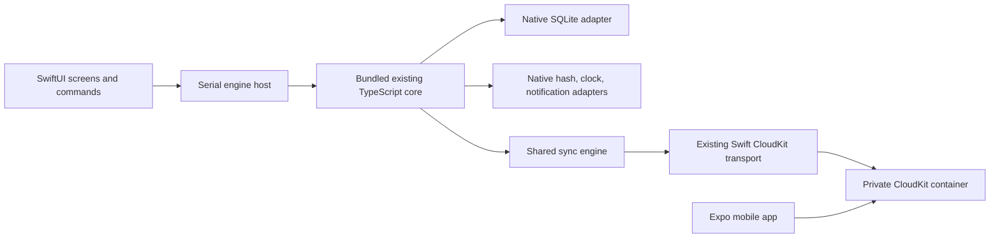
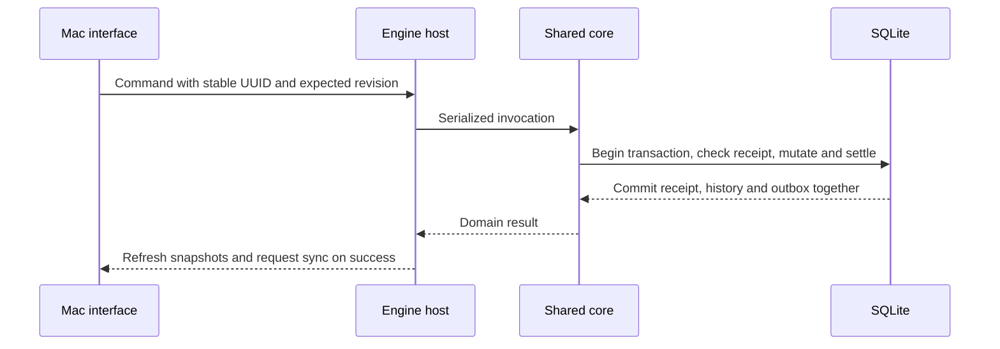

# Native Mac app

## Goal Capsule

Rami can manage the same habits, stacks, coins, rewards, history and settings from a proper Mac app and synchronize changes with the mobile app.
Means: SwiftUI with the existing TypeScript engine hosted by JavaScriptCore (KTD1).
The current request authorizes full app implementation and overrides the older spec's exclusion of macOS UI. Existing product rules remain authoritative. Implementation includes local verification and commits; public distribution is separate.
Stop and report any missing entitlement/account prerequisite that prevents real CloudKit verification. A local transport simulation never proves live sync.

---

## Product Contract

### Summary

Build a desktop counterpart with native navigation, controls, keyboard commands, resizable windows and the full mobile product's functionality.

### Problem Frame

The current implementation is an iOS app. Rami wants to use his existing habit system while working on his Mac without creating a second tracker or a second set of rules.

### Requirements

- R1. Native Mac interface, with sidebar navigation and keyboard-accessible primary actions. This is session-settled: the user chose a proper Mac app over running the iPad app.
- R2. Full habits, stacks, coins, rewards, history, settings and sync. This is session-settled: the user chose full functionality over a daily companion.
- R3. Preserve all domain semantics in `SPEC-habit-system.md` and inherited product rules: daily/count boards, anchors, same-day stacks, append-only coin history, stale mutation checks and idempotent commands.
- R4. Use the same CloudKit container and wire protocol with a separate Mac device/database identity. Sync remains opt-in, preserves account binding, supports offline changes and reports failures.
- R5. Preserve JSON backup/import compatibility and Ripples CSV import, including preview and confirmed restore. Preserve notes, amounts, dates and history.
- R6. Support native notifications for reminders and never-miss-twice, with actual permission/status handling.
- R7. Fresh installs are empty; sample data is explicitly entered in an isolated disposable store. Errors never silently reset data.
- R8. Support light/dark appearance, accessibility labels, narrow windows and long content. Visually inspect actual latest-build windows.
- R9. After the full desktop experience, add and test multiple native widgets, including a GitHub-style activity grid. This is a subsequent explicit user request.

### Scope Boundaries

No new coin economics, seeded personal habits, web service, or shared filesystem database across devices. Public App Store distribution and a menu-bar extension are follow-up work; neither is needed for the desktop app's full main-window functionality. Existing iOS widgets and Shortcuts keep working. The user's subsequent request adds a Mac widget extension after main-window acceptance.

---

## Planning Contract

### Key Technical Decisions

- KTD1. Use SwiftUI for the UI and bundle the existing `src/core` TypeScript with Bun for JavaScriptCore. This shares actual algorithms while retaining native desktop composition. React Native macOS would require a second compatibility effort across Expo dependencies; duplicating all rules in Swift would create drift.
- KTD2. A serial off-main execution lane owns JavaScriptCore and SQLite. Native SQL/hash/UUID functions are private bridge primitives; Swift UI invokes only an allowlisted domain API. Async transactions commit only after their callback settles; failures roll back.
- KTD3. Preserve `DomainResult` and command IDs across the bridge. Swift receives JSON DTOs; mutations never write product SQL directly. Date projections and balances come from core queries.
- KTD4. Reuse the existing Swift CloudKit target through a narrow public JSON facade and Swift package product. Preserve internal wire validation, account bindings and transport error codes. Initialize the database before constructing the transport.
- KTD5. Native orchestration handles window activation, day/time-zone refresh, sync single-flight and retry, generation cancellation, and notifications. Shared sync and reconciliation algorithms remain in TypeScript.
- KTD6. Build the JavaScript bundle as part of every app/test build. Keep generated bundles/build outputs untracked and never hand-edit them. The Mac target lives under `macos/`, beside the existing mobile app.

### High-Level Technical Design

### Assumptions and runtime evidence

Minimum macOS version and final packaging/signing configuration are implementation decisions based on the installed SDK and available signing profile. Initial layout targets 1100 by 760 points and remains usable at 760 by 560.
A real local JavaScriptCore probe already supports Promise callbacks and Intl longOffset for Toronto. TextEncoder is absent and needs exact UTF-8 semantics, including unpaired surrogates. Core itself does not need timers. Full historical calendar and real SQLite integration still require tests.
The existing CloudKit Swift package declares macOS support but currently has no public product/facade. Live two-device acceptance is still open in the mobile project's checklist.

---

## Implementation Units

### U1. Shared engine on macOS

**Goal:** Existing product commands and queries run in a native Mac process with durable SQLite.
**Requirements:** R3, R7; KTD1-KTD3, KTD6.
**Dependencies:** None.
**Files:** `macos/Package.swift`, `macos/Sources/HabitEngine/`, `macos/Tests/HabitEngineTests/`, `macos/bridge/`, `macos/scripts/`, `macos/.gitignore`.
**Approach:** Establish the allowlisted request/result API and generated bundle build. Implement SQL parameter/null mapping, transaction lifetimes, exact UTF-8, hashes and UUIDs. Use a serial host for async JS operations. Expose core queries, commands, import/export and adapter hooks without importing the React provider.
**Patterns:** `src/platform/database/index.ts`, `src/core/persistence/bootstrap.ts`, `src/core/domain/command-context.ts`, `src/core/domain/queries.ts`.
**Execution note:** Start with a failing real-JSC/SQLite integration test before implementation.
**Test scenarios:** Fresh initialization; daily and count creation; toggle and repeated receipt; coin earning/reversal; rollback; persistence after reopening; null/unicode/number binding; migration mismatch retains store; historical calendar and UTF-8 parity.
**Verification:** Actual generated bundle executes against native SQLite and preserves core outcomes. Existing mobile validation stays green.

### U2. Native navigation and full product screens

**Goal:** Manage habits and rewards, view stacks, history and analytics through SwiftUI.
**Requirements:** R1-R3, R8.
**Dependencies:** U1.
**Files:** `macos/Sources/HabitSystem/`, `macos/Tests/HabitSystemTests/`.
**Approach:** Compose a split-view sidebar with Today, Habits, Stacks, Coins, Rewards and History. Use native sheets for forms and confirmations. Display core snapshots, handle loading/empty/error states, and preserve captured revision/confirmation data. Include all editable habit fields, archive/restore/delete, count check-in editing, reward CRUD/claim and analytical history.
**Patterns:** Existing mobile feature screens and core query/command contracts.
**Test scenarios:** Create/edit/archive/restore habit; daily toggle with notes confirmation; count entry with amount/date/note; stale mutation refusal; stack completion; claim then insufficient balance; historical check-in editing/deletion; keyboard focus and navigation.
**Verification:** Drive actual Mac window through representative workflows and inspect light/dark, populated/empty/error and narrow states.

### U3. Settings, transfer, sample and notifications

**Goal:** Complete desktop settings and native integrations.
**Requirements:** R5-R8.
**Dependencies:** U1, U2.
**Files:** `macos/Sources/HabitSystem/Settings/`, `macos/Sources/HabitEngine/Notifications.swift`, `macos/bridge/notifications.ts`, `macos/Tests/HabitEngineTests/NotificationsTests.swift`.
**Approach:** Native file dialogs for shared export/preview/import, anchor presets and archived items. Native notification adapter implements real scheduler ports and errors; reconcile on startup/foreground/time changes. Separate temporary sample engine with effects disabled, disposed on exit.
**Patterns:** `src/core/export/`, `src/core/domain/reminder-commands.ts`, `src/core/domain/miss-alert-reconciliation.ts`, existing sample factory.
**Test scenarios:** Export/import round trip without minting coins; cancelled picker; invalid import preview; permission denial; reminder edit/cancel; never-miss-twice deduplication; sample disposal with unchanged real database.
**Verification:** Native file/notification actions work and shared data invariants survive round trips.

### U4. Shared CloudKit and synchronization lifecycle

**Goal:** Mac and phone use the same private sync service safely.
**Requirements:** R4; KTD4-KTD5.
**Dependencies:** U1.
**Files:** `modules/habit-system-apple/Package.swift`, `modules/habit-system-apple/ios/MacCloudKitFacade.swift`, existing native facade tests, `macos/Sources/HabitEngine/CloudKitAdapter.swift`, `macos/bridge/sync.ts`, `macos/Tests/HabitEngineTests/SyncTests.swift`.
**Approach:** Expose existing transport via a small public facade, map async native errors into the shared SyncTransportError class, retain wire validation. Single-flight sync with local-write/foreground requests, retryAfterMs and cancellation generation. Mac identity and entitlements reference the existing container.
**Test scenarios:** Offline duplicate checks/coin reconciliation; reordered pages; cancellation during fetch; retryable failure; account mismatch; wire payload validation. Signed live Mac/phone create/check/uncheck/reward convergence.
**Verification:** Local two-store tests and native transport tests pass; live sync is separately observed on entitled signed targets, or explicitly remains incomplete with the exact missing prerequisite.

### U5. Packaging, regression and delivery

**Goal:** A launchable current-build Mac app with recorded acceptance evidence.
**Requirements:** R1-R8.
**Dependencies:** U2-U4.
**Files:** `macos/scripts/`, `macos/Info.plist`, `macos/HabitSystem.entitlements`, `macos/README.md`, `checkpoints.md`.
**Approach:** Reproducible local app build including bundle/resources/icon and signing. Launch with a dedicated QA store for test data; preserve real app data. Run required gates and independent review, fix verified defects, document build/run and any live-service blocker.
**Test scenarios:** Cold launch/relaunch, persistence, missing/corrupt bundle, startup recovery, clock changes, offline restart, independent light/dark/narrow visual acceptance.
**Verification:** Current app bundle launches and all applicable checks pass, with evidence and explicit limitations.

### U6. Native desktop widgets

**Goal:** Three visually distinct WidgetKit variations backed by the same shared-engine projections: Activity Grid, Weekly Focus and Today.
**Requirements:** R8-R9; completed after U5.
**Boundary:** The app publishes a minimal atomic snapshot. The extension only reads it, supports habit selection and opens an environment-qualified app link. No widget database, CloudKit client or mutation path. Sample and QA stores cannot replace normal snapshots. Production remains untouched during testing.
**Verification:** Real-engine projection tests, atomic/version/environment/expiry tests, real AppModel cold and sample-transition link tests, signed extension loading in Apple's WidgetKit Simulator, and native visual renders across appearances. Record desktop placement/background-refresh limits separately.

---

## Verification Contract

Use test-first native integration tests for the bridge, real SQLite and JavaScriptCore, shared calendar fixtures, and controlled transport tests. `bun run validate` and `bun run test:native` must remain green. Run the new Mac package tests and reproducible app build. Inspect the actual launched target using native UI automation and screenshots. A compile, accessibility tree or fake transport alone cannot establish visual quality or live sync. Independent non-author verification and a checkpoint entry precede commits.

---

## Definition of Done

All full-app flows are implemented and verified in a running Mac window. Shared rules, backups and sync protocol remain compatible. Generated bundles are fresh. Tests and independent review pass. Each completed unit is committed using lowercase conventional messages without co-author lines. Remove abandoned code and preserve unrelated user edits. Any unavailable signed live-sync acceptance is named as unfinished rather than claimed complete.

## Sources

- `SPEC-habit-system.md`, `SPEC-ripples-product.md`, `AGENTS.md`, `tasks/todo.md`.
- [Apple JavaScriptCore](https://developer.apple.com/documentation/javascriptcore/jscontext).
- [Apple SwiftUI Mac app tutorial](https://developer.apple.com/tutorials/swiftui/creating-a-macos-app).
- [Expo additional platform support](https://docs.expo.dev/modules/additional-platform-support/).
